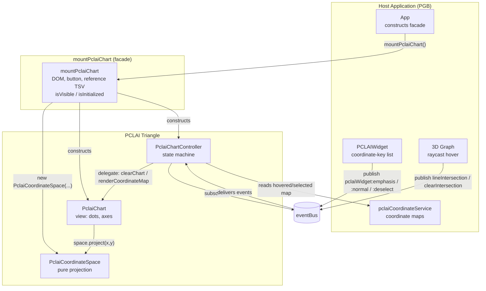
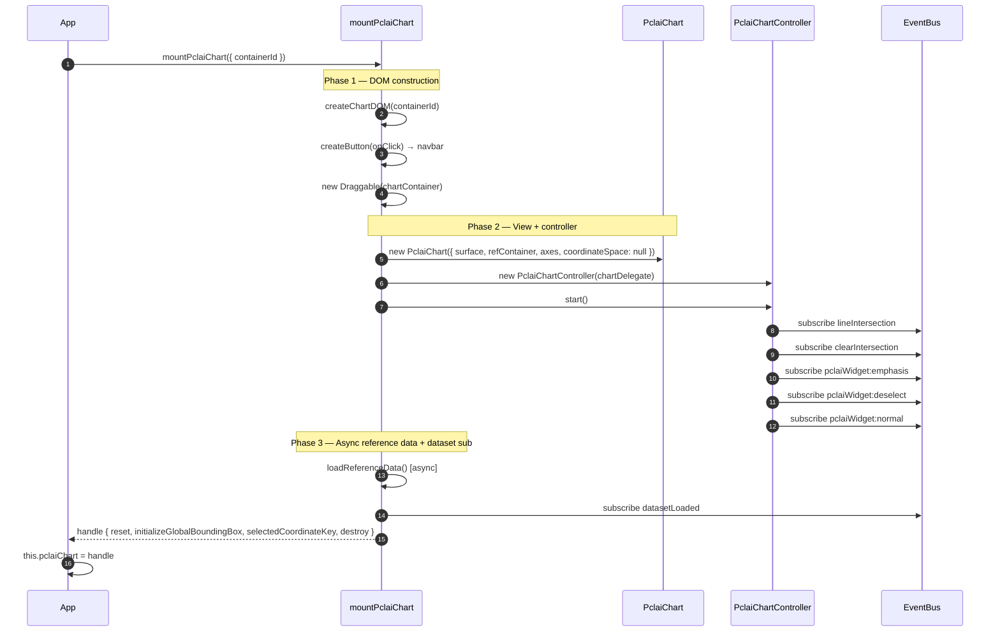
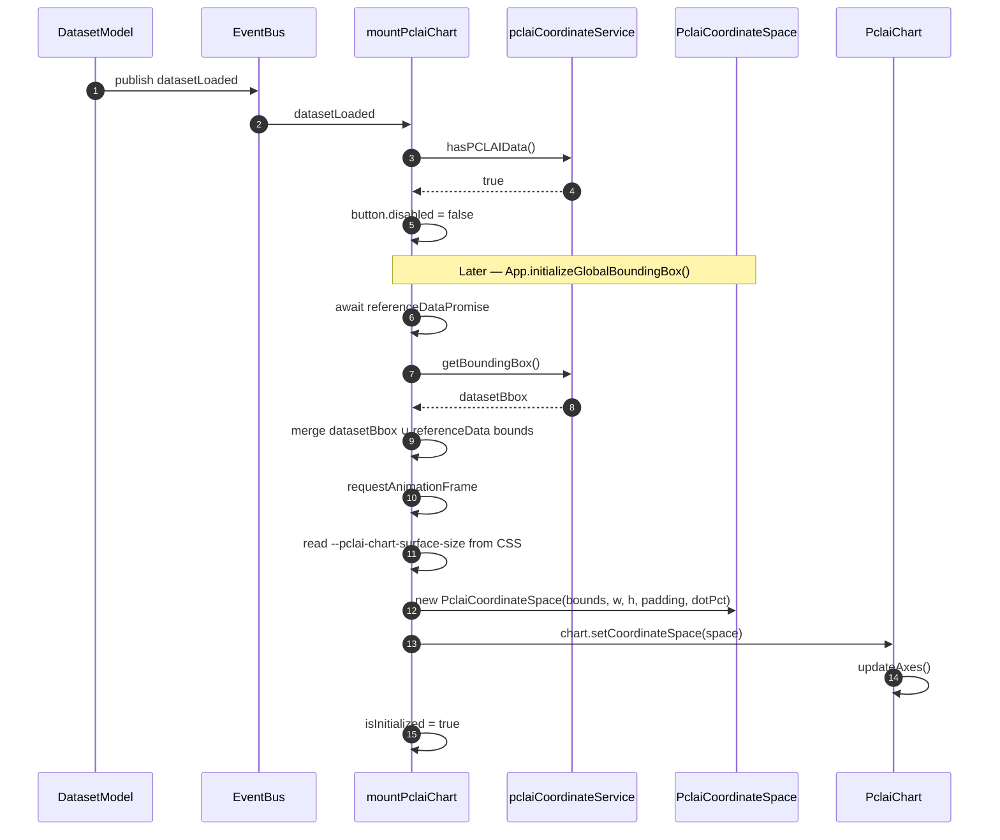
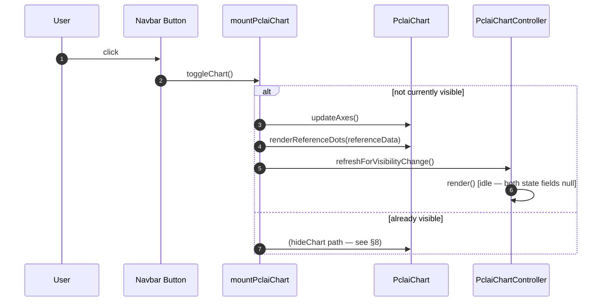
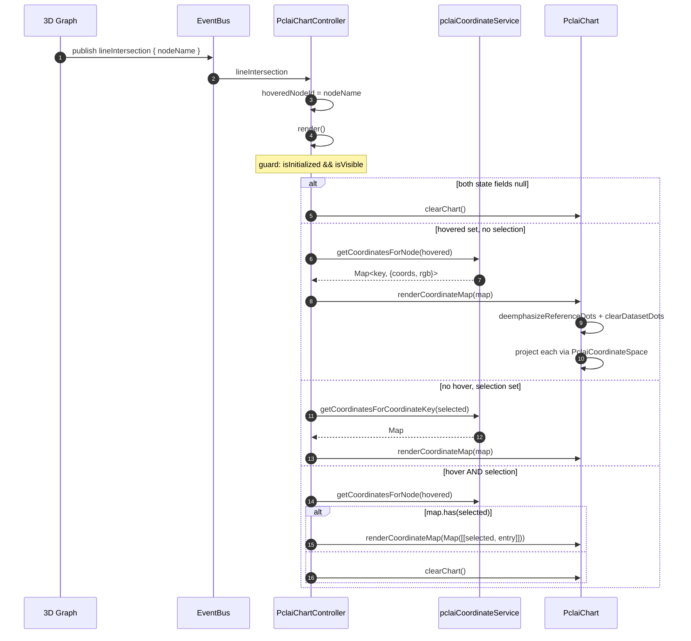
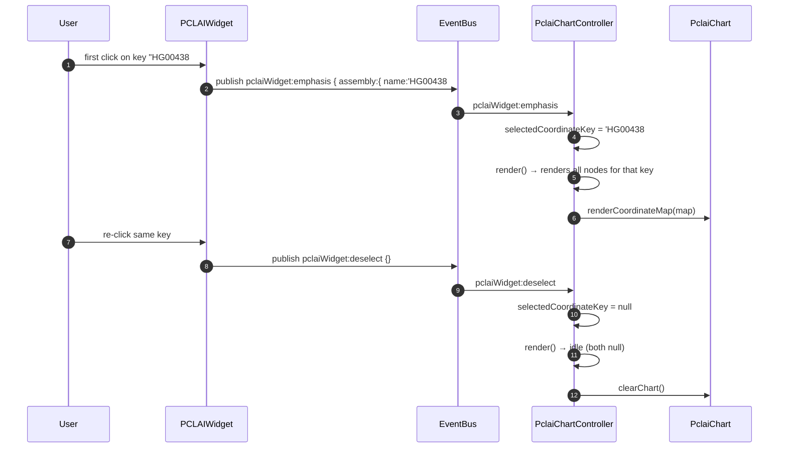
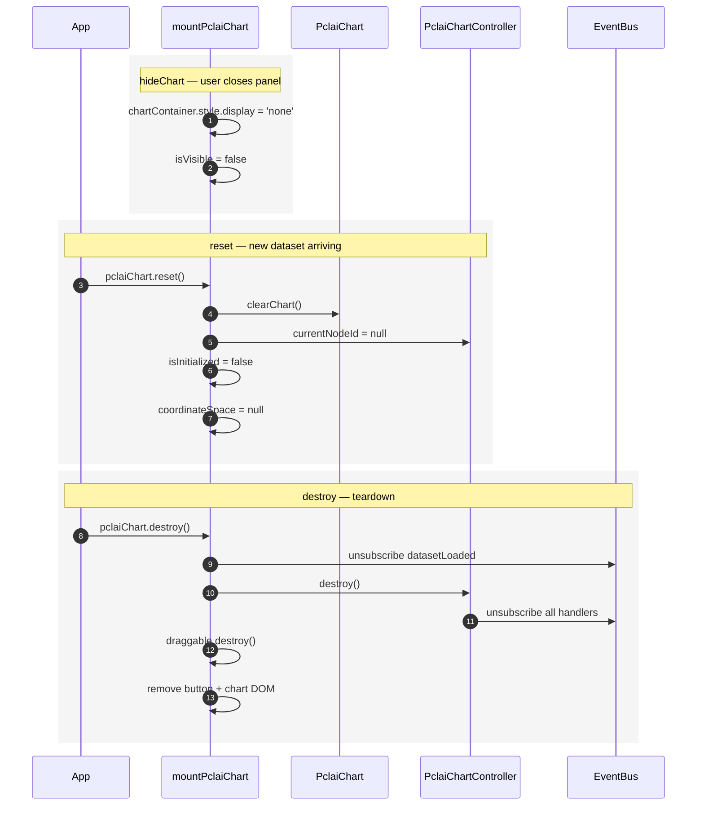
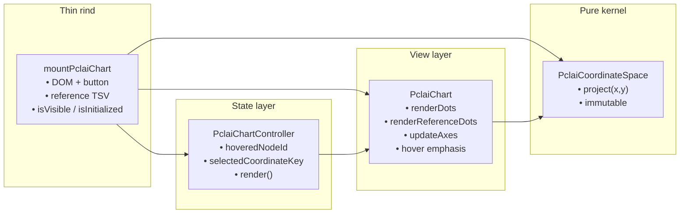

# PCLAI Triangle Interaction Diagrams

Interaction flows for the **PCLAI chart subsystem** after the PR #48 refactor (closes issues #46, #47). The 970-line `pclaiChartService` singleton was split into four small collaborators: a pure projection kernel, a view, a state-machine controller, and a bootstrap facade. (PR #48 also added a refcount absence coordinator; issue #179 removed it — see §7.)

---

## 1. Architecture Overview

The PCLAI chart shows dataset PCLAI coordinates as dots on a 2D scatter plot with a reference-data background. It reacts to two independent signals — 3D-node hover (`lineIntersection`) and PCLAI-widget coordinate-key selection (`pclaiWidget:emphasis`) — and renders as a pure function of `{ hoveredNodeId, selectedCoordinateKey }`.

| Component | Role | Owns |
|-----------|------|------|
| **App** | Orchestrator | Constructs facade once in its constructor; stores handle as `this.pclaiChart` |
| **mountPclaiChart (facade)** | Bootstrap | Card DOM, navbar button, reference-TSV fetch, `isVisible`/`isInitialized` |
| **PclaiCoordinateSpace** | Pure projection kernel | `project(x, y) → { left, top, size }`; immutable; no DOM/events |
| **PclaiChart** | View | Surface, axes, dataset dots, reference dots, hover emphasis, desaturation |
| **PclaiChartController** | State machine | `{ hoveredNodeId, selectedCoordinateKey }`; event subscriptions; single `render()` path |
| **PCLAIWidget** | Sibling presenter | Coordinate-key list card; publishes `pclaiWidget:emphasis` / `:normal` / `:deselect` |
| **pclaiCoordinateService** | Data source | Coordinate maps, bounding box |



### Invariants

| Invariant | Where it lives |
|---|---|
| Projection math lives in exactly one place | `PclaiCoordinateSpace`; pinned by 8 characterization tests |
| View knows nothing about events or dataset | `PclaiChart` has no `eventBus` import |
| Rendered chart is a pure function of `(hoveredNodeId, selectedCoordinateKey)` | `PclaiChartController.render()` |
| 3D node coloring changes only on selection, never on card visibility | `PCLAIWidget` is the sole publisher of `pclaiWidget:emphasis` / `:normal` |

---

## 2. Bootstrap — Full Sequence

`App` constructs the facade exactly once in its constructor. The facade builds DOM, wires up the view and controller, starts the reference-TSV fetch, and subscribes to `datasetLoaded` — all before any dataset has arrived.



### What lives where after bootstrap

| State | Owner | Initial value |
|---|---|---|
| `isVisible` | facade closure | `false` |
| `isInitialized` | facade closure | `false` |
| `coordinateSpace` | facade closure | `null` |
| `referenceData` | facade closure | `[]` (filled by async fetch) |
| `hoveredNodeId` | controller | `null` |
| `selectedCoordinateKey` | controller | `null` |

---

## 3. Dataset Load — Coordinate Space Construction

When a dataset loads, the facade enables the navbar button. Separately, `App.initializeGlobalBoundingBox()` awaits the reference-TSV fetch, merges dataset and reference bounds, reads the surface size from CSS, and constructs the `PclaiCoordinateSpace`. Until this point, hover and widget events fire into a controller whose `isInitialized()` guard short-circuits `render()`.



### Why a two-step init

| Step | Blocked on | Reason it can't happen sooner |
|---|---|---|
| Button enable | `datasetLoaded` | Needs PCLAI presence check |
| Coordinate space | reference TSV + rAF + CSS read | Bounds must union reference data; surface size is CSS-driven |

---

## 4. Show Chart

Clicking the PCLAI Chart button toggles visibility. Showing the chart does not change the 3D graph.



---

## 5. Hover a 3D Node — Controller State Machine

The controller subscribes to `lineIntersection` and `clearIntersection`. Every handler follows the same contract: mutate `{ hoveredNodeId, selectedCoordinateKey }`, then call `render()`. The render path is a single switch on the two state fields.



### The four render branches

| `hoveredNodeId` | `selectedCoordinateKey` | Result |
|---|---|---|
| `null` | `null` | idle — reference dots at full color, no dataset dots |
| set | `null` | all PCLAI keys for that node |
| `null` | set | all nodes that carry that key |
| set | set | single dot for (node, key) if present, else idle |

---

## 6. Widget Re-click — The #47 Fix

Issue #47 was that re-clicking the already-selected coordinate key in the widget should toggle the chart back to idle, but the old service had no channel to learn about the toggle-off. PR #48 added a `pclaiWidget:deselect` event; the controller subscribes to it and clears `selectedCoordinateKey`, which falls through the pure `render()` path to idle. Once the state machine existed, the fix was two lines.



---

## 7. Absence — No Longer a Visibility Concern

PR #48 added `pclaiAbsenceCoordinator`, a refcount gate so that the widget card and the chart panel could both hold the 3D graph in a dataset-wide "absence" mode while visible. Issue #179 removed it: *absent* is now relative to the selected haplotype (see `CONTEXT.md` §emphasized / de-emphasized / absent), so it is computed by `PCLAIWidget` on selection and carried in `pclaiWidget:emphasis`. Card visibility no longer affects the 3D graph, and nothing needs refcounting.

---

## 8. Hide / Reset / Destroy — Lifecycle

The facade owns lifecycle transitions. `reset()` is called on new-dataset load; `destroy()` on teardown. The controller and draggable clean up their subscriptions and DOM listeners.



---

## 9. Component Responsibilities



| Module | Imports eventBus? | Imports DOM? | Imports dataset model? |
|---|---|---|---|
| `PclaiCoordinateSpace` | no | no | no |
| `PclaiChart` | no | yes | no |
| `PclaiChartController` | yes | no | yes (pclaiCoordinateService) |
| `mountPclaiChart` (facade) | yes | yes | yes |

---

## 10. Events Reference

| Event | Published by | Consumed by | Meaning |
|---|---|---|---|
| `datasetLoaded` | DatasetModel | facade | new dataset available; update button state |
| `lineIntersection` | 3D graph raycast | controller | user hovered a node line |
| `clearIntersection` | 3D graph raycast | controller | hover ended |
| `pclaiWidget:emphasis` | PCLAIWidget | controller | user selected a coordinate key |
| `pclaiWidget:deselect` | PCLAIWidget | controller | user re-clicked the selected key (#47 fix) |
| `pclaiWidget:emphasis` | PCLAIWidget | 3D graph Look | paint emphasized / absent / de-emphasized |
| `pclaiWidget:normal` | PCLAIWidget | 3D graph Look, controller | restore every node to normal |

---

## 11. Data Flow Summary

```
user hover / widget click / dataset load
        │
        ▼
eventBus
        │
        ▼
PclaiChartController
        │ (mutate state)
        ├── hoveredNodeId
        └── selectedCoordinateKey
        │
        ▼
render() — pure function of (hovered, selected)
        │
        ├── idle       → PclaiChart.clearChart()
        ├── hover only → pclai.getCoordinatesForNode(h)
        ├── sel only   → pclai.getCoordinatesForCoordinateKey(s)
        └── both       → filter(h, s)
        │
        ▼
PclaiChart.renderDots(map) / clearChart()
        │
        ▼
PclaiCoordinateSpace.project(x, y) → { left, top, size }
        │
        ▼
DOM dots in chartSurface
```

---

## 12. Source Map

| File | Role |
|---|---|
| `src/widgets/pclaiCoordinateSpace.js` | Pure projection kernel |
| `src/widgets/pclaiChart.js` | View |
| `src/widgets/pclaiChartController.js` | State machine |
| `src/widgets/mountPclaiChart.js` | Facade / bootstrap |
| `src/widgets/pclaiWidget.ts` | Sibling presenter (not part of the triangle, but a collaborator) |
| `src/__tests__/pclaiCoordinateSpace.test.js` | 8 characterization tests pinning the projection spec |

Related: [code-architecture-improvements.md § 6](./code-architecture-improvements.md) · PR #48 · closes #46, #47
